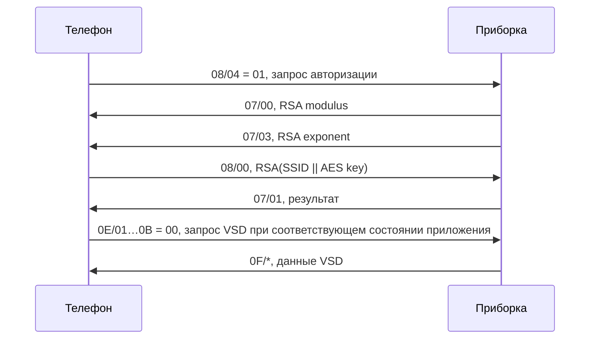

# K1G: разбор протокола оригинального приложения и отличия snatch-dash

**Дата первоначального исследования:** 19.10.2026.  
**Повторная сверка:** 22.10.2026, по Royal Enfield App **10.1.23(45)**,
versionCode **193**, пакет `com.royalenfield.reprime`, APK/Java/smali в
`re_app_new/` и текущему Kotlin-порту. Первоначальные anchors относятся к
10.1.22(8), versionCode 189, в `re_app/`; новые anchors приведены отдельно.  
**Статус:** исследовательский отчёт, не нормативная спецификация прошивки и не
план изменения движка. Исправляется только отчёт; код приложения и диссектор
по результатам повторной сверки не менялись.

Действующий контракт порта — [spec/k1g_protocol.md][protocol-spec]. Номера его
инвариантов этот отчёт не изменяет. Порядок реального захвата —
[PACKET_CAPTURE.md][capture]. Здесь зафиксированы формат проволоки, реальные
обработчики оригинала, границы доказательств и расхождения с текущим портом.
Старый [каталог команд][old-commands] полезен как указатель на константы, но часть
его открытых вопросов и трактовок уже закрыта этим исследованием.

## 1. Источники и уровень уверенности

Обозначения в документе:

- **[код]** — действие видно в достижимом обработчике или сериализаторе
  оригинального приложения; неоднозначные участки проверялись по smali.
- **[порт]** — поведение текущего Kotlin-движка, не автоматически требование
  приборки или копия алгоритма оригинала.
- **[историческое поле]** — наблюдение из уже существующих документов проекта,
  с указанной там датой; в этом исследовании захват заново не снимался.
- **[smoke]** — запуск декодера/настоящего Kotlin-кодека на известных константах
  и синтетических входных данных, не обмен с физическим дэшем.
- **[INFERENCE]** — вывод из перечисленных фактов, а не отдельное наблюдение.
- **Не установлено** — данных для более сильного утверждения нет.

Новый PCAP, Android runtime trace, дамп прошивки и проверка на физической
приборке в этой сессии не выполнялись. Нельзя превращать условие в коде
отправителя в доказательство того, что прошивка требует именно такое условие.

Повторная сверка также статическая. APK 10.1.23(45) имеет SHA-256
`889b9c42f21ef426c114cadac788c9c6220a29dc686e8a5b0e3fbd07a0e4f404`.
REA 6.7.0 идентифицировал архив и манифест через Apktool 3.0.3; method/xref
provider JADX недоступен без отдельно поставляемого `jadx-headless-mcp 0.7.1`.
Поэтому DEX-поведение ниже сверено по локальным Java/smali, а не выдано за
новую REA-декомпиляцию Java. Native-путь Ghidra 12.1.4 доступен и перепроверен
отдельно (§13); наличие одного provider не означает доступность другого.

### 1.1. Основные точки входа

| Участок | Оригинал | Текущий порт |
|---|---|---|
| Константы и динамическая сериализация | [hbg][hbg], [kbg][kbg], [nbg][nbg] | [K1GPacket][packet], [K1GCodec в DashMessage][messages] |
| UDP и очереди | [jbg][jbg], [zx4][zx4], [z9q][z9q] | [DashSocket][socket], [DashSession][session] |
| Входящие TLV | [aaq][aaq], [ykq][ykq] | [DashMessage / K1GCodec][messages] |
| RSA/AES | [idk][idk] | [DashAuth][auth], обработка Identity в [DashSession][session] |
| UI-потребители команд | [NavigationRootFragment][root], [NavigationFragment][nav] | [DashSession][session] и получатели SessionEvent |
| Статус, медиа, звонки | [REForeGroundService][service] | K1GCodec и периодика DashSession |
| Видео | [r2g][r2g], [gwq][gwq], [mbb][mbb], [vzn][vzn] | [DashEncoder][encoder], [NalProcessor][nal], [RtpPacketizer][rtp], [FrameStreamer][streamer] |
| FOTA | [u59][fota], отдельный путь z9q.k() | Эквивалентный автомат в исследованном K1G-пути порта не найден |

`bluconnect` — обфусцированное пространство имён DEX. Нахождение класса в этом
пакете не означает использование Bluetooth: K1G-классы работают с UDP явно.
Оригинальные имена Kotlin-файлов и классов частично сохранились в SMAP metadata.

### 1.2. Что установлено анализом .so через REA/Ghidra

В `config.arm64_v8a.apk` девять библиотек:

| Библиотека | Наблюдаемая принадлежность |
|---|---|
| `libBluConnect-Lib.so` | Два JNI-экспорта получения Firebase-конфигурации |
| `libgmm-jni.so` | Google Maps / Navigation |
| `libbarhopper_v3.so` | Google barcode recognition |
| `libimage_processing_util_jni.so` | CameraX image processing |
| `libsurface_util_jni.so` | CameraX Surface information |
| `libandroidx.graphics.path.so` | AndroidX Graphics Path |
| `libdatastore_shared_counter.so` | AndroidX DataStore |
| `librdpdf.so` | Radaee PDF |
| `libsqlcipher.so` | SQLCipher |

REA 6.7.0 с провайдером Ghidra 12.1.4 декомпилировал оба JNI-экспорта и
инициализатор `libBluConnect-Lib.so`. Отдельный извлечённый файл побайтно
совпадает с библиотекой в split APK:

```text
ELF64 AArch64, stripped
size   = 328336 bytes
BuildID= 54aa98fb25c5e7d8c07b55b57e085e55b9c893cd
SHA256 = cad115a44b5f14cd2007842106e1d8cc16ebbe190018dd3242f32c680025af03
```

| Функция | ELF VA | Адрес Ghidra при image base 0x100000 |
|---|---|---|
| `Java_com_aptener_bluconnect_BluConnectServiceImpl_loadConfig` | `0x21420` | `0x121420` |
| `Java_com_aptener_bluconnect_di_module_FirebaseModule_Companion_FirebaseAppFactory_loadConfig2` | `0x218a4` | `0x1218a4` |
| `_INIT_2` | `0x21dbc` | `0x121dbc` |

Оба JNI-экспорта выполняют одну логику: `applicationId + "*|" + apiKey + "*|" +
projectId`, затем `NewStringUTF`. `true` выбирает `bluconnect-dev`, `false` —
`bluconnect-prod`. Значения собираются статическим инициализатором из констант;
это не расшифровка K1G. API-ключи в отчёт не включены.

[Реальный Java-потребитель][blu-service] вызывает `loadConfig(false)` и
использует три элемента для Firebase options. Для `loadConfig2` Java/smali
привязка в этом APK не найдена; оставшийся экспорт другой версии SDK — только
**[INFERENCE]**.

В исследованных JNI-функциях нет UDP, TLV, RSA/AES или RTP. Остальные восемь
библиотек проверены по инвентарю, экспортам и строковым маркерам, не полным
разбором всех функций. Отсутствие `K1G` в строках само по себе не доказывает
отсутствие скрытого кода. Положительное доказательство принадлежности протокола
DEX — его исполняемые сериализаторы, crypto-вызовы и сетевые отправители ниже.
Android MediaCodec, JCA и сокеты могут исполнять платформенный native code;
это не отдельная K1G-реализация в найденной библиотеке Aptener.

**Повторно 22.10.2026:** библиотека из `re_app_new/native_lib/` и одноимённый
член `re_app_new/split_config.arm64_v8a.apk` имеют тот же SHA-256, что указан
выше; в split девять `.so`. Оба JNI-экспорта и `_INIT_2` снова разобраны
REA/Ghidra. Новый `BluConnectServiceImpl` также вызывает `loadConfig(false)`
и разбирает три части для Firebase (`java:324–331`); это не K1G crypto.

### 1.3. Anchors повторной сверки 10.1.23(45)

Имена и номера строк в первоначальных разделах относятся к 10.1.22, если
версия явно не указана. Таблица ниже связывает их с проверенными путями нового
APK; это семантическое соответствие, не доказательство идентичности всего класса.
Java-корень — `re_app_new/jadx_out/sources/`, smali-корень —
`re_app_new/apktool_out/`. Локальные выгрузки не входят в git.

| Раздел | Старые имена → проверенные источники 10.1.23 |
|---|---|
| §2, оболочка/очереди | `hbg→`[w2c](../re_app_new/jadx_out/sources/bluconnect/w2c.java); `jbg→`[y2c](../re_app_new/jadx_out/sources/bluconnect/y2c.java) `m/n/o/w`; `zx4→`[sw2](../re_app_new/jadx_out/sources/bluconnect/sw2.java) `c/d/h/i/run`; `z9q→`[blk](../re_app_new/jadx_out/sources/bluconnect/blk.java) `k/run` |
| §3–4, auth/VSD | `aaq→`[clk](../re_app_new/jadx_out/sources/bluconnect/clk.java) `B/T/X/Y/o0`; `idk→`[omf](../re_app_new/jadx_out/sources/bluconnect/omf.java) `c/d/h/j/k/m`; `pbh→`[l3d](../re_app_new/jadx_out/sources/bluconnect/l3d.java) `f/n`; критические gates — `smali_classes8/bluconnect/clk.smali:199–305` |
| §5, действия | [NavigationRootFragment](../re_app_new/jadx_out/sources/com/royalenfield/reprime/ui/home/navigation/fragment/NavigationRootFragment.java): `C2/L`, `Y/i9`; [NavigationFragment](../re_app_new/jadx_out/sources/com/royalenfield/reprime/ui/home/navigation/fragment/NavigationFragment.java): `W8/X8/Y9/Z9`; switch `clk.S` — `smali_classes8/bluconnect/clk.smali:1697–2118`, ответы `2930–3028` |
| §6, настройки | `ykq→`[awk](../re_app_new/jadx_out/sources/bluconnect/awk.java) `340–569`; `yah→t2d` prefs; builder `w2c:953–1205`, low-fuel/ABS `clk:1117–1137,1518–1547` |
| §7–8, nav/text | `kbg→`[z2c](../re_app_new/jadx_out/sources/bluconnect/z2c.java) `79–325`; `lbg→a3c`, `fag→u1c`, `j2h→guc`, `n2h→kuc`; `y2c.c/l` связывают caller и encoder |
| §8–9, media/call/status | [REForeGroundService](../re_app_new/jadx_out/sources/com/royalenfield/reprime/ui/home/navigation/service/REForeGroundService.java) `b/d/A/J/x/y/S`; `t9k→zif`; `nbg→`[c3c](../re_app_new/jadx_out/sources/bluconnect/c3c.java) `a/c/d/e/f`; `x9k→djf` bitmap helpers; [b52](../re_app_new/jadx_out/sources/bluconnect/b52.java) и [r42](../re_app_new/jadx_out/sources/bluconnect/r42.java) — call events; `c5r→fgl` weather mapping |
| §10, FOTA | `u59→`[vk6](../re_app_new/jadx_out/sources/bluconnect/vk6.java) `b.a/K/Z/g0/y0`, smali `smali/bluconnect/vk6$b.smali`; raw splitter `blk.k`, `smali_classes8/bluconnect/blk.smali:509–680` |
| §11, encoder/RTP | `r2g→`[gub](../re_app_new/jadx_out/sources/bluconnect/gub.java) `d/e/f`; `gwq→j7l`, `mbb→`[a78](../re_app_new/jadx_out/sources/bluconnect/a78.java), `vzn→`[hbi](../re_app_new/jadx_out/sources/bluconnect/hbi.java), `n6g→cyb`; encoder facade нового пути `w9f→gub` (тождество старому `q0k` не установлено); RTP smali — `smali_classes4/bluconnect/` |


## 2. Транспорт, оболочка и счётчики

### 2.1. Адреса и сокеты

| Канал | Направление | Порт назначения | Способ доставки |
|---|---|---:|---|
| Control TX | Телефон → приборка | 2000 | Broadcast подсети |
| Control RX | Приборка → телефон | 2002 | На RX-сокет телефона |
| RTP/H.264 | Телефон → приборка | 5000 | Unicast |

**[код]** `jbg.m()` создаёт `DatagramSocket(2000)`, привязывает его к выбранному
Android Network, включает broadcast, затем открывает `DatagramSocket(2002)` и
запускает приёмник. Отправитель `jbg.w()` запускается после этого. Broadcast
выводится из интерфейса; не следует считать `192.168.1.255` частью формата.
Оригинальный RTP-путь `n6g` использует `192.168.1.1:5000`.

**[порт]** Адреса выводятся из LinkProperties с запасными значениями;
[DashPeerLatch][latch] однократно принимает адрес отправителя подтверждения
авторизации как адрес назначения RTP. Control остаётся broadcast.

Источники: `jbg.java:153–173,241–266,327–340`; `n6g.java:39–61`;
`NavigationRootFragment.D0()`.

### 2.2. Общая оболочка — 8 байт, затем TLV

| Смещение, с нуля | Размер | Значение |
|---|---:|---|
| 0 | 2 | `outer_len`: полная длина датаграммы, включая это поле |
| 2 | 2 | `seg_count`: объявленное число сегментов |
| 4 | 4 | Reserved; в исследованном исходящем пути нули |
| 8 | переменный | TLV: `group:u8, sub:u8, length:u16BE, value[length]` |

Длины, число сегментов и многобайтовые численные поля оболочки — big-endian.
Интерпретация value зависит от конкретного TLV: там встречаются бинарные числа,
ASCII-цифры, строки, флаги, шифротекст и прикладные структуры.

Телефон добавляет первым TLV служебный сегмент:

```text
02 01 00 05 | 4B 31 47 20 | seq
```

Его value — ASCII `K1G ` и один seq-байт. Поэтому команды телефона начинаются
на offset 17, magic находится на 12–15, seq — на 16. `02 01` и `00 05` здесь
можно разобрать как group/sub и length обычного TLV, а не как независимые
глобальные flags/const.

**Входящий путь не требует этого служебного TLV.** `aaq.T()` берёт число
сегментов из `[2:4]`, пропускает первые восемь байт и запускает TLV walker.
Он не проверяет magic и не сверяет `outer_len` с фактической длиной. Текущий
`K1GPacket.parseIncoming()` также начинает с offset 8.

Нельзя называть reserved `[4:8]` входящим аналогом seq на offset 16. Эти поля
различны; наличие счётчика в одном направлении не доказывает его наличие в
другом. **[историческое поле]** Раздел об RX в [спецификации][protocol-spec]
сообщает нули в `[4:8]` во всех разобранных там пакетах 13.09 и 27.09.2026;
это не новый замер данного исследования.

### 2.3. Seq, периодика и надёжность

**[код]** Обычный путь `zx4.i()` меняет byte 16 прямо перед
`DatagramSocket.send()`: значения идут `00…FF`, затем снова `00`.
Это порядок отправки, не номер видеокадра. Обобщённого control-ACK с привязкой
к seq и общей retransmit-очереди в этом пути не найдено. Ответы кнопок,
crypto-повторы, периодические состояния и FOTA имеют отдельную семантику.

Для transfer-сообщений FOTA есть отдельная очередь: `zx4.h()` (10.1.23:
`sw2.h`) отправляет bytes без patch seq; глобальный режим `I2` (новый `z2`)
очищает/подавляет normal queue. Однако начальные `0A01/0A02` из нового
`vk6` идут **normal-путём с patch byte16**. RX `0B` снимает этот режим
до state gate; это не непрерывная блокировка normal traffic на весь update.

### 2.4. Проверенные примеры и несогласованные длины

Полный AuthRequest из `hbg.e`, 22 байта:

```text
0016 0002 00000000 02010005 4B31472000 08040001 01
```

Текущий `K1GCodec.encode(AuthRequest)` побайтно воспроизводит эту константу.

Случаи, запрещающие слепо считать все шаблоны строго согласованными:

| Случай | Объявлено | Фактически / статус |
|---|---|---|
| Обычный AuthRequest | 22 байта, 2 сегмента | Совпадает; один сегмент служебный |
| Текущий captured heartbeat | 73 байта, 11 сегментов | 12 физических TLV с учётом `02/01`; count сохранён из захвата |
| `hbg.d`, `U2…c3`, `k0`, `k1` | Объявления длины будущего сообщения | Незавершённые runtime-префиксы; их внутренняя согласованность не гарантирована |
| `hbg.o3`, запрос VSD | 67 байт, 12 сегментов | 72 байта, 12 TLV; длина неконсистентна |
| Chassis echo `U2` (подтверждено `w2c.U2`) | outer_len 36, `06/13 length=17` | Для 17 plaintext-байт полная длина 38; шаблон внутренне противоречив |

`o3` состоит из служебного сегмента и одиннадцати `0E/01…0B`, каждый с одним
нулевым байтом. Путь достижим: успешный auth → `NavigationRootFragment.e2()` →
при наличии vehicle-parameter listener `c9()` → `pbh.f(hbg.o3)` → normal queue →
patch seq → send. `pbh.f()` лишь переводит hex в bytes, длину не исправляет.
**[код]** Следовательно, ошибка не объясняется только неиспользуемой константой.
Принятие/отбрасывание такой датаграммы прошивкой не проверено.

Источники: `hbg.java:555`; `NavigationRootFragment.java:5630–5632,5759–5774`;
`pbh.java:147–159`; `zx4.java:143–154`. Captured-count особенности порта
описаны в `K1GPacket.build()` и `Scripts.initialBurst()`.

В 10.1.23 запрос VSD достижим через `clk.X → Root.h2 → Root.Y8` при
ненулевых Context и vehicle listener; `l3d.f(w2c.o3)` и `sw2.i` длину
не исправляют. Для `U2` caller так же просто дописывает расшифрованные bytes:
`0024 … 0613 0011` требует минимум 38 байт при объявленных 36.
Это отдельная ошибка шаблона, даже если входной chassis имеет ожидаемую длину.

## 3. Авторизация: сообщения, криптография и повторы

### 3.1. Обмен



Modulus и exponent могут прийти разными датаграммами. `aaq.X()` накапливает их
как hex-строки, вызывает callback при наличии обоих и очищает обе строки.
Сами числа интерпретируются `new BigInteger(hex, 16)`, без разворота байтов.

### 3.2. Алгоритмы и границы

| Свойство | Наблюдаемая реализация оригинала |
|---|---|
| RSA transformation | `RSA/ECB/PKCS1Padding`: PKCS#1 v1.5 |
| Источник RSA-ключа | Полученные modulus/exponent через `RSAPublicKeySpec` |
| Ожидаемый ciphertext | 128 байт: `08 00 0080`; шаблон предполагает RSA-1024 |
| RSA plaintext | `ssid.getBytes()` затем 32 байта AES-ключа, без разделителя |
| AES key | 32 случайных байта `SecureRandom` |
| AES transformation | `AES/CBC/PKCS7Padding` |
| Зашифрованное value | `IV[16]` + ciphertext |
| JCA provider | По имени/объекту не задан; фактический provider выбирает runtime |
| Успешный результат | Всё value `07/01` в точности равно `01` |

Оригинал создаёт `idk` как singleton и генерирует ключ при его первом создании.
По исследованным Java/smali-вызовам другой регенерации `idk.m()` и сброса этого
singleton не найдено. Поэтому точнее говорить о **process-singleton AES-ключе
оригинала**, а не гарантировать новый ключ на каждое WiFi-подключение.

Текущий `DashAuth` генерирует новый AES-ключ при формировании `SendKey`,
защищается от повторной выдачи того же offer через `keySent`, а K1GCodec явно
требует ciphertext длиной 128 байт. SSID кодируется UTF-8 и ограничивается
85 байтами, чтобы вместе с AES-ключом уложиться в лимит 117 байт PKCS#1 v1.5
для RSA-1024. Реальный WiFi SSID короче этого предела.

### 3.3. Повторы оригинала и отличие порта

| Стадия | Оригинал | Текущий порт |
|---|---|---|
| До RSA offer | Первичная отправка и максимум пять повторов через nominal 3 с; первый обработанный `07`, даже неизвестный sub, снимает ожидание | Запрос раз в 2 с, пока не получена часть ключа; ожидание 15 с после initial burst |
| Ciphertext отправлен | Первичная отправка и максимум пять повторов того же ciphertext через nominal 3 с; seq меняется при каждой отправке | Эквивалентного периодического повтора ciphertext в исследованном пути нет |
| Rejected | Отдельный счётчик в `aaq.l`, до пяти новых запросов; таймер ciphertext отменяется | Сброс offer-state и до пяти запросов после reject |
| Повтор полного RSA offer | Оригинал может снова вызвать генерацию ciphertext с тем же singleton AES | `keySent` подавляет повтор до reset |
| Accept | Весь value равен `01` | Первый байт равен `01`; session дополнительно проверяет наличие `sessionKey` |

Источники: `aaq.X()`; `idk.java:46–60,162–211`;
`NavigationRootFragment.java:2499–2527,2842–2854,4258–4271,5714–5726`;
`DashAuth.ingest/reset/buildKeyPacket()`; `DashSession.dispatch()`.

В новом Root у request/ciphertext разные Handler runnable, но общий `F2`,
сбрасываемый на переходах; отдельный reject-counter остаётся в `clk.l`.
Три секунды — задержка планирования Handler, не гарантия точного wire interval.

Есть дополнительная граница защиты порта: `DashAuth.reset()` очищает RSA-пару
и `keySent`, но не `sessionKey`; session принимает accept при ненулевом
`sessionKey`. **[INFERENCE]** После reject эта проверка доказывает наличие
ключа одной из прошлых попыток, а не отправку ключа текущей попытки. Это
вывод по состояниям кода, не воспроизведённая атака и не наблюдение прошивки.
Более того, `sessionKey` присваивается до RSA encrypt и помещения ciphertext
в outbox (`DashAuth.buildKeyPacket`): даже в первой попытке ненулевой ключ
сам по себе не доказывает состоявшуюся UDP-отправку.

### 3.4. Что авторизация не доказывает

- `07/01=01` — открытый статус, не подпись и не доказательство владения AES.
- В исследованном пути нет pinning RSA-идентичности приборки.
- AES-CBC здесь не сопровождается MAC; успешный padding не делает данные
  аутентифицированными.
- Осмысленная расшифровка VSD сильнее одного байта статуса как свидетельство
  владения ключом, но не доказывает доверенную идентичность производителя.
- Экспозиция ограничена доступом к сети приборки; вывод об эксплуатации на
  конкретном устройстве это исследование не устанавливает.

## 4. Vehicle Secure Data: запрос, поля и ответы

### 4.1. Условие запуска разбора оригинала

`aaq.B()` ищет в hex-тексте **той же датаграммы** все девять маркеров:

```text
0F01 0F02 0F03 0F05 0F06 0F07 0F08 0F09 0F0A
```

Только после этого `Y()` проходит TLV и вызывает `o0()`. Проверка — поиск
подстрок, не накопление полей между датаграммами и не проверка подлинности.
Отдельный `0F04` или `0F0B` сам по себе через этот путь не обрабатывается.
Aggregate gate проверен по `smali_classes12/bluconnect/aaq.smali`.

### 4.2. Полная установленная карта

Последний столбец — **жёстко объявленная длина plaintext в исходящем echo
оригинала**, не измеренный размер входящего ciphertext и не валидация
расшифрованного поля.

| RX | Декодирование / назначение | Echo TX | Объявлено plaintext-байт |
|---|---|---|---:|
| `0F 01` | UTF-8 chassis number → `setChassisNo` | `06 13` | 17 |
| `0F 02` | UTF-8 serial number → `setSerialNumber` | `06 14` | 24 |
| `0F 03` | AES-decrypted bytes; назначение не установлено | `06 15` | 13 |
| `0F 04` | **Не AES:** первый байт `55` → safe mode false, `AA` → true | Нет в этом обработчике | — |
| `0F 05` | AES-decrypted BSSID; сохраняется как uppercase hex | `06 16` | 6 |
| `0F 06` | UTF-8 manufacturing date; формат даты не проверяется | `06 17` | 10 |
| `0F 07` | UTF-8 hardware version | `06 18` | 24 |
| `0F 08` | UTF-8 part number; также fallback part-number variant | `06 19` | 8 |
| `0F 09` | Расшифрованные байты сворачиваются big-endian в Java int; region сохраняется десятичной строкой | `06 1A` | 2 |
| `0F 0A` | FOTA version: при длине строки >4 последние четыре символа группируются попарно через точку | `06 1B` | 11 |
| `0F 0B` | UTF-8 variant; удаляется один конечный NUL, если присутствует | Нет в этом обработчике | — |

FOTA-строка для интерфейса преобразуется, но в `06/1B` возвращаются полные
расшифрованные байты, не отформатированная строка. Завершение aggregate-пути
условно: при наличии vehicle listener вызывается его callback; внутри этой
ветки при наличии auth listener вызывается completion. В 10.1.23 это
`Root.h0 → Ha`: отмена VSD timeout и сохранение cluster record при ненулевом
Context. Завершение этого пути не доказывает успешную расшифровку всех полей.
VSD query имеет собственные повторы через Handler: initial + максимум пять.

Источники: `aaq.java:98–108,818–832,905–911,1239–1429`;
`hbg.java:272–375`; `NavigationRootFragment.f0()/Na()`.

### 4.3. Ошибки расшифровки и открытые ответы

`idk.c()` возвращает UTF-8 строку, `idk.d()` — bytes. При пойманной ошибке
`doFinal()` они возвращают соответственно пустую строку и `{00}`. Копирование
IV и инициализация Cipher находятся вне этих локальных catch, поэтому нельзя
говорить, что любые короткие/повреждённые данные безопасно проглатываются.
Кроме того, `0F0B` обращается к последнему plaintext-байту без проверки
пустого массива (`clk.java:1256–1273`). Gate из hex-подстрок не гарантирует
наличие настоящих девяти TLV: маркеры могут встретиться внутри ciphertext.

Оригинал нередко расшифровывает поле дважды: для строки и для echo bytes.
Echo `06/13…1B` отправляется **открытым текстом**, с заранее заданными длинами,
склеенными с фактическим результатом расшифровки без проверки его длины.
Шифрование входящего `0F` поэтому не означает сквозную конфиденциальность
этих данных на WiFi.
Chassis echo дополнительно наследует внутренне неверный `U2` (§2.4);
normal sender меняет только seq, не исправляет outer/TLV lengths.

**[порт]** Любой `0F` классифицируется как `Identity`, независимо от sub;
предпринимается AES-расшифровка для DebugLog. Нет эквивалентных aggregate gate,
полной записи полей, plaintext echo и safe-mode действия для `0F04`.

## 5. Входящие команды и действия приложения

### 5.1. Карта групп

| Группа | Что реально делает исследованный оригинальный путь |
|---|---|
| `01` | Семантика не установлена; normal dispatcher не имеет содержательного обработчика |
| `03` | Настройки приборки → телефон, разбор через `aaq` / `ykq` |
| `07` | RSA offer и результат авторизации |
| `09` | Кнопки, списки, управление проекцией/компасом, sync settings, analog mode |
| `0B` | FOTA-ответы, отдельный raw-dispatch в `z9q.k()` |
| `0C` | Разобраны low-fuel mode и ABS preferences; остальная карта неизвестна |
| `0F` | VSD по специальному aggregate-пути |

Литералы в `hbg` не являются автоматически исходящими командами: часть нужна
для сравнения с входящими пакетами. Простая инвентаризация строк смешивает
направления.

### 5.2. `09 04/06`: поправка к названию «frame decoded»

| RX | Эффект оригинального обработчика | TX |
|---|---|---|
| `09 04 0001 55` | `aaq.a0()` → `s05.z2()` → событие `stop video feed`; активный экран навигации при работающем guidance и `!C3` останавливает проекцию | `06 12 0001 55` |
| `09 06 0001 55` | `aaq.Z()` → `J(false)` → сброс compass-triggered state и bearing | `06 11 0001 55` |
| Те же sub с `AA` | В этих двух обработчиках нет действия/ответа | — |

Цепочка stop: `NavigationRootFragment.z2()` публикует `L2=true`;
`NavigationFragment.S8()` регистрирует наблюдатель; `T8()` при нужном состоянии
вызывает остановку, `V9()` освобождает encoder и отправляет `06/05=AA`.
Это подтверждается действиями, не только текстом log.
В 10.1.23 соответствующая цепочка — `Root.C2 → NavigationFragment.W8/X8 →
Y9 → Z9`; `Y9` запускает отдельный Thread. Ответ `06/12` следует после
публикации события, но не подтверждает завершение остановки encoder.

Источники: `aaq.java:424–475,835–850`;
`NavigationRootFragment.java:4228–4238,7628–7632`;
`NavigationFragment.java:1865–1907,3844–3851`.
Dispatch и сравнения с `55` проверены по smali.

**Граница вывода:** исследованные 10.1.22 и 10.1.23 не устанавливают IDR/P-frame
ACK или decoder-open semantics этих двух команд. Текущий порт называет их
`DecoderOpened(keyFrame=...)`, сохраняет ответы и обновляет счётчики, но
не выполняет соответствующие оригинальные stop/compass действия.

**[историческое поле]** [spec/video.md][video-spec] описывает нормальный
видеопоток при длительном отсутствии этих уведомлений, в частности заезд
29.08.2026. Это отвергает необходимость per-frame ACK в том наблюдении, но
не превращает уведомления в доказанные decoder-open milestones. Автоматическая
смена обработчиков порта требует отдельной проверки на его прошивке.

### 5.3. `09 00`: команды кнопок

Оригинал берёт **первый** байт value, порт — **последний** непустого value.
Для обычного однобайтного события результат одинаков; длинные формы требуют
учёта направления и фактического захвата. Switch в JADX повреждён; карта
проверена по `smali_classes12/bluconnect/aaq.smali`, метод `S()`.
В 10.1.23 switch также проверен по `clk.smali:S`. Media helpers и compass
дополнительно ищут полный literal `09000001XX`; первый байт нужного кода
при объявленной length=2 сам по себе не гарантирует действие/ACK оригинала.

| Code | Эффект оригинала | Непосредственный ответ |
|---|---|---|
| `03` | Call volume up | `06 80 03` |
| `04` | Call volume down | `06 80 04` |
| `05` | Play/pause | `06 80 05`, если media callback существует |
| `06` | Music volume up | `06 80 06`, callback требуется |
| `07` | Music volume down | `06 80 07`, callback требуется |
| `08` | Toggle music mute | `06 80 08` |
| `09` | Next track | `06 80 09`, callback требуется |
| `0A` | Previous track | `06 80 0A`, callback требуется |
| `0B` | Start navigation | `06 80 0B` |
| `12` | Stop navigation | `06 80 12` |
| `13` | Zoom in | `06 80 13` |
| `14` | Zoom out | `06 80 14` |
| `15` | Recenter | `06 0C 30`, затем `06 80 15` |
| `17` | Establish call | В показанном callback только log, без ответа |
| `18` | Вызов `m9()` (10.1.23: `i9()`): отправка счётчика missed calls `06/0A`; подпись log «start music» не доказывает запуск музыки | Прямого button echo в callback нет |
| `19` | Navigation notification/destination action | `06 80 19` |
| `20` | Remove waypoint | `06 80 20` |
| `21` | RSA-call action: создаётся call intent | `06 80 21`; запуск intent этим callback не доказан |
| `22` | Compass mode on | `06 80 22` |

В оригинале ACK находится внутри отдельных callback, часто после действия;
нет универсального «echo до любой работы». Текущий session ставит в outbox
`ButtonAck` до выдачи события приложению для каждой классифицированной кнопки.
Это правило порта, не свойство всех оригинальных обработчиков.

`06/0C` сообщает результат zoom: `30` — применено, `20` — верхняя граница,
`10` — нижняя. Оригинал может отправить applied и bound двумя пакетами: условия
независимы. Это не просто подтверждение получения кнопки, которое уже имеет
собственный `06/80`.

### 5.4. Индексированные запросы

| RX | Первый байт value | Второй байт value | Смысл |
|---|---|---|---|
| `09 01` | `00…04` | `55` | Выбор favourite contact |
| `09 01` | `00…04` | `AA` / `BB` / `CC` | Выбор received / missed / dialled call |
| `09 01` | `AA` | `55` / `AA` / `BB` / `CC` | Запрос соответствующего списка целиком |
| `09 03` | `00…04` | `0A` / `0B` / `0C` / `0D` | Выбор gas / restaurant / workshop / parking |
| `09 03` | `00…04` | `14` / `1E` | Выбор saved/favourite / recent destination |
| `09 03` | `AA` | Один из перечисленных context-кодов | Запрос соответствующего списка |

`09/02` в исследованном методе только логируется как current track index;
полное действие не установлено. `09/05=01` запускает синхронизацию настроек,
`09/07=55/AA` передаёт analog-mode callback true/false.

Источники: `aaq.java:153–416,479–485,687–765,1036–1047,1569–1635`.

## 6. Настройки и plaintext-телеметрия

### 6.1. Направления семейств `03` и `04`

| Настройка | TX телефон → приборка | RX приборка → телефон | Значения |
|---|---|---|---|
| Температура | `04 01` | `03 03` | `55` °C, `AA` °F |
| Расстояние | `04 02` | `03 04` | `55` km, `AA` miles |
| Theme | `04 03` | `03 05` | TX `10` Auto / `20` dark; RX `55` Auto / `AA` dark |
| Расход | `04 04` | `03 06` | `10` km/l, `20` l/100km, `30` MPG, `40` MPG-US |
| Часы | `04 06` | `03 08` | `55` 24-hour, `AA` 12-hour |
| Язык | `04 07` | `03 09` | `01` English, `02` Italian, `03` Spanish, `04` Portuguese, `05` German, `06` French |
| Уведомления | `04 08` | `03 0A` | Пять флагов: messages, incoming calls, weather, contextual, vehicle alerts |
| POI | `04 09` | `03 0B` | Четыре флага: gas, restaurant, RE workshop, parking |

В массивах уведомлений/POI **`AA` означает включено/выбрано, `55` — выключено**.
В индексированных запросах те же байты обозначают классы списков. Нельзя вводить
глобальное правило «55=true, AA=false» для всего K1G.

В `hbg.a0()` (10.1.23: `w2c.a0`) при распознанных preferences получаются
восемь TLV в порядке
`04/08 → 04/09 → 04/01 → 04/02 → 04/03 → 04/04 → 04/06 → 04/07`.
Header count=9 захардкожен: неизвестные scalar preferences могут опустить
поле без пересчёта count. Настройки отправляются при INFOTAINMENT в показанном
пути. RX сравнивается с preferences и может вызвать повтор app settings.

В оригинальных literal shortcuts есть несогласованные формы `030A0004...`
наряду с подробным пятифлаговым разбором `030A`; detailed POI-путь использует
`030B0004`. Эти формы не нормализовались в отчёте до вымышленного единого формата.

Источники: `hbg.java:968–1240`; `ykq.java:340–569`;
`aaq.java:979–1104`.

### 6.2. Что удалось установить для `0C`

| RX | Длина в распознаваемом шаблоне | Реальный обработчик |
|---|---:|---|
| `0C 05` | 1 | Low-fuel mode. `55` включает, любое другое значение снимает активное состояние. При переходе off → on запрашиваются gas-station POI; повторный on не дублирует запрос |
| `0C 14` | 1 | `00`: PrefAbs=true; `01`: PrefAbs=false; `02`: EcoAbs=true; `03`: EcoAbs=false; после распознанной команды уведомляется observer, даже если значение уже совпадало |
| `0C 01` | Префикс объявляет 1 | Константа есть, содержательный обработчик не найден |
| Остальные sub | Здесь не установлена | Исследованный normal dispatcher не даёт достоверной семантики/масштаба/единиц |

Low-fuel — boolean mode, не измеренный уровень топлива. Название `EcoAbs`
взято из preferences; его нельзя без дополнительных данных превращать в более
сильное утверждение о физическом состоянии ABS.

**[историческое поле]** В [спецификации][protocol-spec] перечислены 26 разных
входящих `0C` по полевому логу 13.09.2026. Это инвентарь, а не 26 восстановленных
значений. Текущий порт сохраняет их как raw `Telemetry` и логирует.

Источники: `aaq.java:1113–1133,1516–1540`; `t9k.lowFuelModeActive`;
`yah` с именами preferences `PrefAbs` / `EcoAbs`.

## 7. Навигация, списки и периодика

### 7.1. Динамический nav-пакет оригинала

`kbg.w()` собирает поля в следующем порядке; часть пропускается по значению.

| TLV | Представление | Условие / замечание |
|---|---|---|
| `05 01` | Road/instruction text + NUL | Null/empty опускаются; особый encoder, см. §8 |
| `05 02` | Primary maneuver, 1 байт | Не посылается для `-1` |
| `05 03` | Secondary maneuver, 1 байт | Посылается всегда; `-1` становится `FF` |
| `05 04` | Primary distance, u16 BE | Не посылается при `<=0` |
| `05 05` | Secondary distance, u16 BE | Не посылается при `<=0`; caller использует primary + next-step distance |
| `05 06` / `05 07` | Primary/secondary unit, 1 байт | `10`: km в десятых; `20`: miles в десятых; `30`: metres; `50`: feet; zero опускается |
| `05 08` | Четыре ASCII-цифры `HHMM` | Не binary HH/MM и не BCD |
| `05 54` | ETA format enum | Encoder проверяет input `1/2`, выдаёт `10/20`, иначе `30` |
| `05 09` | Remaining distance, u16 BE | Не посылается при `<=0` |
| `05 46` | Remaining-distance unit, 1 байт | Zero опускается |
| `05 0A` | Decimal separator flag, 1 байт | Raw hex `55` / `AA` |
| `05 0C` | Maneuver proximity/progress, 1 байт | `-1` опускается; когда вычисленное значение >=5, caller подавляет secondary maneuver |
| `05 0B` | Шесть ASCII-цифр `HHMMDD` | Duration: часы, минуты, дни |
| `05 55` | Duration unit selector, 1 байт | `10` / `20` / `30` |
| `06 05` | Projection flag, 1 байт | Из `lbg.o`, всегда в хвосте перед `06/0D` |
| `06 0D` | Второй display boolean, 1 байт | Из `lbg.p`; полная firmware-семантика не установлена |

Есть source-level несогласованность ETA format: caller выдаёт `10/20/30`, а
encoder сравнивает с `1/2`. В исследованном обычном пути получается `05/54=30`;
при этом сами часы caller при 12-hour настройке остаются 12-hour. Это ошибка
согласования caller/encoder, не доказательство задуманной enum-семантики прошивки.

Источники: `kbg.java:85–314`; `jbg.c()`; `j2h.java`; `n2h.java`.

**[порт]** Динамическая навигация перенесена лишь частично:

| Поля | Текущий `K1GCodec` |
|---|---|
| Secondary maneuver / distance `05/03,05/05` | RouteCard сохраняет `34` / `0000`, не следующий манёвр SDK |
| Progress `05/0C` | Capture-константа `04` |
| Duration `05/0B,05/55` | `"001000"` / `20`, не live duration |
| Primary distance `05/04` | Отдельный ActiveNav, не RouteCard |
| ETA format `05/54` | `30`; Dart передаёт 24-hour часы |
| Separator / second display boolean | `05/0A=55`, `06/0D=AA` |

Живые maneuver/ETA/remaining distance не делают перечисленные поля живыми.
Источники: `DashMessage.kt:179–224`, `DashSession.routeCard/activeNav`.

### 7.2. Контекст списков и имена порта

`05/2E=0A/0B/0C/0D` выбирает контексты gas/restaurant/workshop/parking;
`14` — saved/favourite, `1E` — recent destinations. `05/2F…33=00` очищает
пять слотов списка.

Текущий `NavContext` — это `05/2E=1E`, то есть байты с самостоятельным
установленным применением к recent-list context в оригинале. Текущий
`NavStart` — `06/80=0B`, побайтно тот же ответ, который оригинал отправляет
из обработчика start-navigation button. Не следует делать из имён порта
доказательство двух независимых firmware-opcode «войти в nav» / «начать nav».

### 7.3. Оригинальные producers и scripts порта

| Producer | Оригинал | Текущий порт |
|---|---|---|
| Начало подключения | Hostname → clock → `05/57=55`, отдельные projection-off/auth ветки | Скрипт из 9 команд, пауза 20 мс после каждой |
| Projection-live `05/56=55` | После подачи bitmap, delayed fallback и отдельные nav producers (`10.1.23: k9/l9/u7/v6`); не только frame timer | Во время STREAMING каждые 250 мс |
| Nav metadata | Callback Google Navigation SDK | RouteCard, затем ActiveNav раз в секунду |
| Статус телефона/погода | Fixed-rate 1000 мс, начальная задержка 0 | Heartbeat раз в секунду, также до STREAMING |
| Музыка | Metadata/playback callbacks, dedup | NowPlaying раз в секунду при наличии состояния |
| Звонок | State callbacks + periodic active caller | Caller раз в секунду; clear один раз при исчезновении |
| Clock | Отправка на connection path; 30-секундный timer в исследованных путях не найден | TimeSync раз в 30 с |

[Scripts.enterNavMode()][scripts] порта воспроизводит последовательность:
context 40 мс → empty lists 40 мс → четыре off route card с паузами
100/500/500/500 мс → projection-live 60 мс → placeholder 10 мс →
`06/80=0B` 40 мс → on route card.

Эти паузы, повторы и правило «один раз за сессию» — действующий контракт порта,
происходящий из его истории захватов/совместимости. **Из исследованных
оригинальных DEX-callsites универсальная необходимость такой choreography
не следует.** Original lifecycle и независимые producers не равны единому
фиксированному startup script.

В порте tick loop запускается до initial burst, поэтому независимые heartbeat
и clock могут интерливиться с ним. Скрипт задаёт свой внутренний порядок, не
обязательно полный порядок всех датаграмм на проводе.

При остановке оригинал освобождает encoder и отправляет projection-off;
некоторые UI-пути сначала отправляют projection-stop. Это не доказательство
единой пары на каждом lifecycle-переходе. При guarded farewell-остановке порт
ставит в очередь `05/56=AA`, затем `06/05=AA`; это не обещание отправки при
любой потере соединения.

## 8. Кодировки текста: три разных пути

### 8.1. Navigation `05/01`

Caller ограничивает road/instruction name до 19 UTF-16 units. Затем
`fag.b()` конкатенирует **unpadded** `Integer.toHexString(char)` для каждого
Java char. `kbg.m()` не отправляет поле, если hex длиннее 38 символов или
после добавления `00` его длина нечётна.

| Input | Результат оригинального encoder | Результат |
|---|---|---|
| `A` | `41` | `05 01 0002 41 00` |
| `Я` | `42F` | TLV целиком пропускается из-за нечётной hex-длины |
| `ЯЯ` | `42F42F` | `05 01 0004 42 F4 2F 00` |
| `😀` | UTF-16 surrogates → `D83DDE00` | Не UTF-8; дальнейшее отображение прошивкой не проверено |

Это не корректный универсальный UTF-8 или UTF-16 wire encoder. Сохранение
ASCII-примеров не позволяет объявить протокол Unicode-совместимым.

Источники: `fag.java:31–43`; `kbg.java:199–216`; `j2h.java:130–149`.

### 8.2. Media, hostname и periodic caller

`pbh.n()` дополняет однозначный hex до двух цифр; Java char выше `FF`
заменяется байтом `FF`. Значит `Я → FF`, emoji-суррогатная пара → `FF FF`.
Это один байт на UTF-16 unit с substitution, не UTF-8.

Hostname оригинала ограничен 19 Java chars и заканчивается NUL.
Periodic active-call text использует аналогичный plaintext-путь.
Но event caller `05/22` в 10.1.23 идёт иначе:
`NavigationRootFragment.onCallDialed/onIncomingCall` → `b52.e/h` →
`r42.h` → `omf.g` → `r42.y/d`. `omf.g` преобразует каждый UTF-16 unit
в один байт (char <255 — напрямую, иначе `FF`), добавляет NUL **до**
AES/CBC/PKCS7Padding и возвращает `IV[16] || ciphertext`.
Название `encrypt2` здесь действительно соответствует шифрованию.

Ограничение event name тоже отличается: `r42.h` режет имя до 19 units
только при `length >20`; имя длиной 20 сохраняется. При пустом имени
используется номер без этой обрезки. Следовательно, даже один sub `05/22`
не означает единую форму value: в этих callsites есть encrypted event
и plaintext periodic. Firmware-приём обоих форматов здесь не проверялся.

Новые источники: `bluconnect/b52.java:64–72,104–113`,
`r42.java:213–220,268–277,611–625`, `omf.java:130–159`;
`REForeGroundService.java:423–440`.

### 8.3. Текущий порт

**Актуально на 22.10.2026:** `K1GCodec.displayText` использует Android ICU
`NFC; Russian-Latin/BGN; Any-Latin; Latin-ASCII`, затем ASCII с заменой
оставшихся non-ASCII code points на `?`. Лимит применяется к результату
транслитерации: route title — 60 байт, каждое media-поле и caller — 20 байт.
Исходная работа ICU ограничена 4096 UTF-16 units без разрыва surrogate pair;
ASCII fast path не требует транслитератора.

Hostname остался отдельным UTF-8-путём с byte-limit 200 и NUL в конце.
Route title/caller также заканчиваются NUL, media разделяется двумя NUL
без терминатора после artist. Прежнее описание media как `take(20)` перед
UTF-8 устарело после смены baseline 20.10.2026; переносить его в новые тесты
нельзя. Это не доказательство поддержки кириллицы прошивкой и не копия
lossy encoder оригинала. Источник: `DashMessage.kt`, `encode/displayText`.

## 9. Статус телефона, погода, музыка, звонки и обложки

### 9.1. Поля оригинального статусного пакета

| TLV | Содержимое оригинала |
|---|---|
| `06 08` | Weather glyph: `01` cloud, `02` thunder group, `03` rain, `04` snow/ice, `05` clear, `FF` unknown |
| `06 10` | Температура °C +40; TLV опускается при sentinel temperature=200 |
| `06 03` | GPS provider enabled: `55` / `AA` |
| `06 04` | Battery percentage +100; Android battery property 4 |
| `06 0F` | Charging/full `55`, иначе `AA` |
| `06 01` | Registered cellular level >0 → `01`, иначе `00`; поле может отсутствовать при недоступности/permissions |
| `05 4C` | Music volume: `10` silent, `11…1A` buckets |
| `05 2D` | Округлённое `t9k.i()` в двух байтах BE; более сильное назначение здесь не установлено |
| `05 1B` | Call volume: `10…1A` |
| `05 21` | В status task: incoming `0A`, active `14`, no-call `32`; outgoing `1E` отправляется отдельным call-event helper |
| `05 4D` | В исследованных путях `32`; более глубокий смысл не установлен |

WeatherEngine сворачивает коды провайдера в пять glyph-групп. `06/04` —
не громкость, а `06/08` — не media flag. Варианты оригинального пакета имеют
длины `003F/0044/0049` в зависимости от omission temperature/cellular.
Mapping нового `fgl.getWeatherIconID` не является идеальной классификацией
погоды: `MOSTLY_CLOUDY_W_FLURRIES_43` попадает в группу `02`, а несколько
других flurries/cold/windy вариантов дают `-1` (`FF`). Названия групп в таблице
не следует превращать в универсальное правило для всех provider codes.

Шкала volume использует `D=(max-min)/10f`, но **не вычитает min из current**.
Первый подходящий включительный диапазон выигрывает; последний — `[9D,11D]`.
Положительный current вне диапазонов оставляет volume TLV отсутствующим.
Выбор header `003F/0044/0049` эту дополнительную потерю не учитывает.
Это дефект sender, а не требование копировать omission или нормализованную
шкалу из плана порта.

**[порт]** Heartbeat оставляет weather=`05`, GPS=`55`, battery=`A2`, charging=`AA`
и другие capture-values. При default temperature=25 wire temperature=`41`.
Это фиксированные данные, не текущие показания телефона. План погоды и
[спецификация мультимедиа][media-spec] отдельно описывают состояние реализации.

Источники: `REForeGroundService` status task и `k()`;
`c5r.java:14–41`; `K1GCodec.encode(Heartbeat)`.

### 9.2. Музыкальный автомат оригинала

| TX | Значение |
|---|---|
| `05 0D` | `album 00 title 00 artist`; нет конечного NUL после artist |
| `05 17` | Media active `55` / inactive `AA` |
| `05 19` | Playing `55` / paused `AA` |
| `05 58` | Artwork follows `55` / no artwork `AA` |
| `05 40` | JPEG artwork fragments |

Обычные поля metadata ограничены 19 UTF-16 units и проходят `pbh.n()`.
Metadata callback обрабатывается через счётчик каждый второй раз, включая
увеличение счётчика на null. Обработанный callback null **игнорируется**;
прямой initial `A(null)` отправляет inactive. Initial вызов обходит counter,
но проходит общий dedup. All-null gate идёт до advertisement; пустые строки
не равны null, whitespace не равен empty.

Dedup требует nonnull mediaId, совпадающий без учёта регистра, и nonnull raw
title с точным совпадением; выполняется до art/artist/album/ad updates.
Playback callback всегда посылает active, включая null; только PLAYING/PAUSED
добавляют `05/19`. Initial bind явно не воспроизводит текущий playback.

В 10.1.23 узкий `IllegalStateException` catch вокруг сборки/отправки карточки
и art-ветки отправляет дополнительную card-only `("NowPlaying","","")`
в порядке album/title/artist. Getters/thumbnail extraction находятся вне
этого catch; fallback не очищает уже поставленные в очередь art/marker.
Источники: service Java `211–237,671–740,811–822`; smali `A:598–800`.

Порт отправляет `title 00 album 00 artist`, ICU→ASCII до 20 байт на поле,
повторяет карточку по таймеру. Это не byte-for-byte перенос автомата оригинала.
Какой порядок полей рисует конкретная прошивка, статический sender не доказывает.

### 9.3. Звонки

`05/21` передаёт состояние звонка, `05/22` — caller/contact card, причём event
и periodic value различаются (§8.2). В 10.1.23 `r42.u` отправляет выбранный
call state, затем отдельный `05/4D=32`; завершение даёт `05/21=32`.
Порт имеет отдельный `CallClear`, сериализуемый как plaintext `05/22=00`,
а heartbeat всегда несёт captured `05/21=32`, не live call state.
Active caller оригинала может дублироваться в секундной периодике.
`spec/multimedia.md` описывает главным образом media-автомат; полного
сравнения call FSM и всех исключений в ней нет.

### 9.4. Прикладная фрагментация обложки

Оригинал создаёт JPEG 75×75, quality 50. Изображение передаётся control TLV,
не RTP. Все указанные длины включают только value соответствующего TLV:

| Пакет | Value `05/40` | TLV value length |
|---|---|---|
| Первый | `00`, затем totalJPEGLength:u16BE, затем image bytes | image bytes +3 |
| Средний | index:u8, затем image bytes | image bytes +1 |
| Последний | `FF`, затем image bytes | image bytes +1 |

Порции данных обычно до 1000 байт. Для JPEG **1…1000 байт** после первого
пакета идёт отдельный пустой FF terminator. Пустой массив — не этот случай:
оригинальный slicer пытается прочитать первый блок 1000 байт и выходит за
границы; размер >65535 обрезается в BE16. Producer спит 10 мс после enqueue,
включая последний; это не замер интервала между датаграммами на проводе.

Есть source-level крайний случай: при размере **2000,3000,… байт** final remainder
равен нулю, а код не подставляет вместо него 1000; последний полный блок
теряется. Ветка проверена по smali. Это дефект конкретного sender, не свойство,
которое следует копировать в совместимую реализацию.

Источники: `nbg.java:21–57,76–95,103–143`; `x9k` JPEG helper;
`smali_classes12/bluconnect/nbg.smali`.

## 10. FOTA: отдельный автомат на том же UDP

Основная пара семейств — исходящее `0A`, входящее `0B`. На RX raw splitter
`z9q.k()` активируется, если **первый TLV** имеет group `0B`, и передаёт
записи слушателю FOTA. Для последующих записей он формирует восьмибайтный
нулевой prefix перед TLV. Обычный `aaq.b0()` для `0B` лишь логирует сообщение.

`u59.b.a()` (10.1.23: `vk6.b.a`) выполняет state-specific обработку sub,
только если он совпадает с ожидаемым `q`. Но **до** проверки совпадения
сбрасывается retry timer и снимается firmware-режим sender: несовпадение
не означает отсутствия побочных действий. Ниже `vN` — offset внутри value,
не всей переданной обработчику записи.

| RX sub | Обработка оригинала |
|---|---|
| `01` | `v0=AA`: принято, переход к `0A03`; pending требует одновременно `v0=55` и `v1=78` |
| `02` | `v0=AA`: software-version response; APP version читается десятичными парами из `v13–14`, `v16–17` при соответствующем запросе |
| `03` | `v0=AA`: supported block size из `v2,v3`, переход к transfer |
| `04` | `v0=AA`: block ACK, u16BE block id из `v3,v4` сравнивается с ожидаемым; `v2` выбирает продолжение стадии |
| `05` | `v0=AA`: restart/advance partition/final stage в зависимости от `v2` |
| `06` | `v0=AA`: отправка header/следующего блока по внутреннему состоянию |
| `07` | При непустом manifest map: успешная ветка требует response ≥104 байт с prefix/TLV-header и `AA` в `v0,v10,v19,v28,v37,v46,v55,v64,v73,v82,v91` |

Комбинация `v0=55,v1=78` встречается в `01–07`: перевзводится retry timer
и обнуляется retry counter; в `02` лог называет её `Failure code`.
`AA` здесь означает успешный ответ, не универсальный boolean K1G.
Block-size буквально вычисляется как signed `v3 | (v2 << 8)`, без unsigned
masks. Минимум 104 байта для `07` включает 8-байтный prefix и 4-байтный TLV-header
(value ≥92); это локальный guard успешной ветки, не общая валидация parser.

Источники: `z9q.java:158–199`; `u59.java:146–413,844–864`.

`0B02` в исторических логах сопутствовал возвращению приборки. Это
наблюдение не отменяется, но его протокольная роль шире «маркер оживания»:
оригинал имеет содержательный FOTA/version handler.

**[порт]** Восьмой шаг initial burst содержит `0A/02` value
`AA55000000000000`. В оригинале тот же TLV отправляет `vk6.K()` как
**запрос software versions**; ответ используется для проверки доступности
обновления и затем сравнения с manifest. Сам запрос не запускает чтение
manifest или transfer: это последующий путь `v0/Y/Z`, reflash начинается
с `0A01`. Наличие `0A02` в burst не доказывает nav-настройку, обязательность
для auth или начало update. Прошивка здесь не обновлялась.

## 11. Видеопоток H.264/RTP

### 11.1. Encoder и реальные presets

| Параметр | Оригинал, navigation path | Текущий движок |
|---|---|---|
| MIME / размер | AVC `video/avc`, 526×300 | То же |
| Input | Surface, `0x7F000789` | COLOR_FormatSurface |
| High | 4 fps, 204800 бит/с, feed 250 мс | Moving: 4 fps, 200000 бит/с |
| Low | 2 fps, 102400 бит/с, feed 500 мс | Idle: 2 fps, 100000 бит/с |
| Запрошенный I-frame interval | 1 с | 2 с, при declared codec fps=4 |
| Profile | Baseline=1, только если найден в capabilities | Запрос Baseline |
| Level | Level первой profile-level записи; при >131072 заменяется на 16384 | AVCLevel41 |
| Bitrate mode | Явно не задан | CBR при поддержке |
| Priority / latency | Явно не заданы | Priority 0, latency 1 frame |
| Output dequeue timeout | 12000 мкс | 10000 мкс |

Это параметры запроса MediaCodec, не замер фактического SPS/GOP каждого
телефона. Интервал IDR при изменении фактического feed fps не обязан совпадать
с wall-clock секундами, переданными в MediaFormat.

В 10.1.23 при INFOTAINMENT выбирается high для `0 < distance <1000 м`
и обнуляется reference distance. В ветке `distance >1000 м` нулевой reference
сначала запоминается; low выбирается при **абсолютной** разнице ≥200 м,
затем reference обновляется. Это не пара порогов 1000/1200 м. Ровно 1000 м,
0 и null данные ветки не переключают.

**[INFERENCE по use sites]** Поле preset — старое `P3`, новое `G3`; оно
меняет feed/snapshot cadence. Параметры fps/bitrate читаются при создании
encoder; в проверенной новой цепочке `w9f→gub` live `setParameters()` не найден.
Порт выбирает профиль по движению камеры и вызывает live bitrate update.
Это различие реализации, не wire-инвариант.

Источники: `NavigationFragment.java:730–752,872–888,949–972,6814–6836`;
`NavigationRootFragmentViewModel.java:835–837`; `r2g.java:84–147`;
`DashEncoder`; [StreamProfile][profile].

### 11.2. RTP header, timestamp и FU-A

| Поле / предел | Оригинал | Текущий движок |
|---|---|---|
| Fixed header | 12 байт; byte0=`80`: V2, без padding/extension/CSRC | То же |
| Payload type | 96; byte1=`60` или `E0` с marker | То же |
| RTP sequence | Старт integer=0, preincrement: первый сформированный=1, low16 BE | Случайное начальное 0…65534, затем modulo65536 |
| SSRC | Случайный, один на packetizer | Случайный, один на packetizer |
| Clock | 90000 Гц | 90000 Гц |
| Timestamp | MediaCodec presentationTimeUs → ns → 90кГц, без random base в активном пути | random32 base + `videoPtsMs*90`, modulo2³² |
| Marker | Single unit или последний fragment целого поданного buffer | Последний пакет последнего NAL данного AU |
| Single-unit threshold | 1358 байт | 1380 байт |
| FU-A data chunk | До 1358 байт +2 FU header | До 1378 байт +2 FU header |
| Максимальный UDP payload | Single1370 / FU1372 байта | 1392 байта |

Точная арифметика original timestamp: `((90000/1000)*(ns/100))/10000`, low32 BE.
Порт продвигает `videoPtsMs` по каждому не-config выходному кадру на 250/500 мс,
не по каждой попытке drain; шаги RTP составляют 22500/45000 ticks.
Clock и RTP sequence продвигаются до попытки enqueue AU; overflow-drop
не откатывает их. Это не счётчик успешно доставленных приборке кадров.

FU-A использует type28, S=`80`, E=`40`, исходный NAL type — low5 bits. Original
сохраняет NRI и очищает F, текущий sender сохраняет F и NRI. В `mbb` встречается
константа1372 и в `vzn` buffer1400, но реальные comparisons/chunk lengths —
указанные в таблице; это разные величины.

Источники: `mbb.java:31–38,83–140,163–195`; `vzn.java:74–105,248–283`;
`RtpPacketizer.kt:110–189`. Timestamp original проверен также по
`smali_classes7/bluconnect/vzn.smali`.

### 11.3. SPS/PPS и большие keyframe buffers

Оригинальный `r2g.e()` сравнивает codec flags по точному равенству:
`2` кэширует codec-config, `1` склеивает config и keyframe, остальные flags
передают buffer как есть. Если при keyframe кэша нет, этот путь его не enqueue.
Timestamp берётся из PTS соответствующего output buffer.

Активный queue-backed `mbb` читает первые пять байт, принимает пятый за NAL
header и считает длиной unit весь остаток текущего queued buffer. Внутренние
Annex-B start codes он не ищет. При обычном четырёхбайтном leading start code
после склейки получается один unit `SPS || prefix || PPS || prefix || IDR`.
Большой такой buffer идёт через FU-A с type первого SPS. Это вывод из кода,
не подтверждение корректности RFC-пакетизации или принятия прошивкой.

Optional parameter-set injection ветка `mbb.e()` не является доказанным
активным STAP-A-путём: её поля в исследованном smali остаются null.

Порт разбирает 3/4-byte Annex-B prefixes, кэширует SPS/PPS, пропускает SEI/AUD.
При наличии обоих cached parameter sets bundle до 1380 байт сохраняется
вместе с IDR; больший bundle разделяется на SPS/PPS/IDR. Каждый из них
фрагментируется только при **собственном** размере >1380: split bundle
не обязательно означает FU-A для IDR.
SPS rewrite имеет точный guard: size≥4, `(byte0 & 0x1f)==7`, byte1=`42`,
byte3=`29`; byte2 заменяется на `00`. Literal byte0=`67` — лишь частный случай.
Необходимость rewrite для прошивки из оригинального sender не следует.

Таким образом, старое утверждение «SPS/PPS-поведение полностью совпадает»
нужно ограничивать: для больших keyframe buffers wire-пакетизация отличается.

### 11.4. Очереди и старт sender

| Политика | Оригинал | Текущий движок |
|---|---|---|
| Очередь encoded buffers | Static, 30 элементов; при заполнении drop oldest | Четыре ожидающих AU плюс обрабатываемый sender; overflow дропает новый целый AU |
| RTP buffers | Ring300×1400, semaphores могут блокировать packetizer | Пакеты собираются для AU перед enqueue |
| Начало UDP передачи | Первые31 committed RTP packets не отправляются; packet32 первый допустимый | Такого startup discard нет |
| Пауза без пакетов | Sender выходит после ожидания около4 с, сбрасывает ring/counter | Собственный lifecycle stream/session |
| Разборка | Очистка static encoded queue при start/stop не найдена | Отмена, не drain AU-очереди; проверка отмены между пакетами |

Startup discard подтверждён smali postincrement и условием `oldCounter>30`.
После timeout sender сбрасывает ring/discard counter, и следующий запуск
снова пропускает 31 пакет; RTP sequence этим reset не обнуляется. Первый
сформированный пакет изначально имеет seq1, первый допустимый к отправке —
seq32. Не следует копировать это как требование K1G.
Timestamp deltas original sender не превращаются в показанном пути в
per-packet sleep/pacing.

Источники: `r2g.java:208–223`; `gwq.java:24–82`;
`vzn.java:207–229,287–345`; `FrameStreamer` sender/outbox/teardown.

## 12. Что в текущих описаниях требует оговорки

Этот раздел не меняет нормативные инварианты порта и не предлагает молча
переключать его поведение на поведение другого APK/firmware.

| Прежняя трактовка | Более точная граница по этому исследованию |
|---|---|
| `09/04,06` — P/IDR decode ACK или доказанный decoder-open | Оригинальные callback имеют stop-video / compass-off эффекты; смысл firmware-сигнала требует проверки |
| Весь `0F` — AES ciphertext | `0F04` — открытый safe-mode byte; другие поля имеют прямое подтверждение по setter, а не только внешний lead |
| Весь `0C` не расшифрован по смыслу | Low-fuel `05` и ABS prefs `14` установлены; остальные не угадывать |
| `0B02` — только маркер возвращения | В оригинале есть FOTA/software-version handler |
| `55/AA` — универсальные boolean | Есть инверсные settings flags, категории списков и FOTA status enums |
| Все строки UTF-8 | Original nav — unpadded char-hex; media/hostname/periodic caller — lossy bytes; event caller — encrypted bytes; порт display text уже ICU→ASCII |
| Скрипт порта — обязательный алгоритм оригинала | Это действующий capture-derived контракт порта; original lifecycle/callbacks устроены иначе |
| Строковые константы — полный исходящий command inventory | Они смешивают RX patterns, TX, templates и dead constants; dynamic TLV отсутствуют в таком inventory |
| Все TX-префиксы внутренне согласованы | `U2` противоречит своей TLV length, `o3` объявляет неверный outer_len; normal sender длины не исправляет |
| RouteCard воспроизводит всю живую навигацию оригинала | Secondary/progress/duration остаются capture-константами |

Смысловые подписи [Lua-диссектора][dissector], некоторые комментарии
[DashMessage][messages], [spec/video.md][video-spec] и старого
[каталога команд][old-commands] могут отставать от этих результатов. Успешный
разбор bytes диссектором подтверждает структуру, не правильность его text label.

## 13. Проверка и воспроизводимость

### 13.1. Что действительно запускалось

Проверки ниже относятся к **19.10.2026**, а не к текущему дереву после ICU-cutover:

| Проверка исследования | Результат |
|---|---|
| REA analyze/function с Ghidra12.1.4 | Декомпилированы два JNI-экспорта и native initializer; SHA совпал с split APK |
| Native JNI ABI probe | `NewStringUTF offset=0x538`, exit0 |
| Decoder по framed-константам `hbg` | 99 literals:86 самосогласованных полных,12 runtime-prefix,1 complete с неверным outer_len |
| Kotlin compiler на настоящих пяти protocol source files | Exit0 |
| Standalone Kotlin codec scenario | Exit0; без mock-реализации K1GCodec |

Kotlin smoke включал `K1GPacket.kt`, `DashMessage.kt`, `DashCommand.kt`,
`DashGlyphs.kt`, `Scripts.kt`. Проверены:

- точное совпадение AuthRequest с `hbg.e`;
- побайтное равенство NavStart и ButtonAck(0B);
- synthetic RX без TX magic/seq: auth accepted, отдельные `09/06=55` и `AA`,
  двухбайтная кнопка с trailing code;
- patch seq `FF→00` без изменения исходного массива;
- length-mismatch/truncated-TLV counters на synthetic input;
- физическое число TLV heartbeat и тогдашний UTF-8 media payload порта.

Пример использованной **синтетической**, не захваченной датаграммы:

```text
001D0004000000000701000101090600015509060001AA09000002AA09
```

Настоящий K1GCodec декодировал её в `AuthResult(true)`,
`DecoderOpened(true)`, `Unknown` для `09/06=AA`, `Button(code=09, raw=AA09)`.
Здесь `DecoderOpened` — фактическое имя типа порта, не подтверждение его
протокольной интерпретации. Временный smoke source/JAR удалены; постоянные
тесты и runtime-код не добавлялись.

### 13.2. Повторить проверку структурных констант

Запускать из корня репозитория с имеющейся локальной декомпиляцией `re_app_new`.
Скрипт читает исходник, ничего не отправляет в сеть и не изменяет файлы.
Он не заменяет проверку достижимости найденной константы.

```python
from pathlib import Path
import re
import struct

source = Path('re_app_new/jadx_out/sources/bluconnect/w2c.java').read_text()
literals = re.findall(r'\bString\s+(\w+)\s*=\s*"([0-9A-Fa-f]+)";', source)
counts = dict(framed=0, complete=0, prefix=0, mismatch=0)
prefix_conflicts = []
for name, text in literals:
    if len(text) % 2 or len(text) < 34:
        continue
    if text[16:32].upper() != '020100054B314720':
        continue
    raw = bytes.fromhex(text)
    declared_len, declared_count = struct.unpack_from('>HH', raw)
    counts['framed'] += 1
    pos, actual_count, truncated = 8, 0, False
    required_end = 0
    while pos < len(raw):
        if pos + 4 > len(raw):
            required_end = pos + 4
            truncated = True
            break
        size = int.from_bytes(raw[pos + 2:pos + 4], 'big')
        pos += 4
        if pos + size > len(raw):
            required_end = pos + size
            truncated = True
            break
        pos += size
        actual_count += 1
    if truncated:
        counts['prefix'] += 1
        if required_end > declared_len:
            prefix_conflicts.append((name, declared_len, required_end))
    elif declared_len != len(raw) or declared_count != actual_count:
        counts['mismatch'] += 1
        print(name, 'length', declared_len, len(raw),
              'segments', declared_count, actual_count)
    else:
        counts['complete'] += 1
print(counts)
print('prefix minimum-length conflicts:', prefix_conflicts)
```

Для исследованного файла полная самосогласованность — только структурный
критерий. Скрипт намеренно не приписывает семантику командам и называет
усечённые literals prefix-кандидатами; их назначение подтверждается callsites.

Повторно 22.10.2026 на `w2c`: `framed=99`, `complete=86`, `prefix=12`,
`mismatch=1`. Единственный complete mismatch — `o3`: outer_len 67 при
72 фактических байтах, объявленные/фактические TLV 12/12. Совпадение этих
счётчиков с 10.1.22 не означает побайтную идентичность всего DEX.
Проверка минимально необходимой длины усечённого TLV отдельно выявляет
`U2`: declared 36, minimum 38. Поэтому «12 runtime-prefix» не означает
«12 внутренне корректных шаблонов».

Также проверены длина синтетического примера §13.1 (29 байт) и SHA-256
библиотеки внутри нового ARM64 split. Текущий Android ICU runtime здесь
не запускался; исторический standalone Kotlin smoke не доказывает новую
транслитерацию.

### 13.3. Повторить native decompilation через REA/Ghidra

Для повторной сверки 22.10.2026 использованы Ghidra12.1.4 и JDK21 по путям
ниже. Все три `rea function` выполнены успешно; это статическая декомпиляция,
не вызов JNI внутри Android:

```bash
export GHIDRA_INSTALL_DIR=/opt/homebrew/Cellar/ghidra/12.1.4/libexec
export JAVA_HOME=/opt/homebrew/opt/openjdk@21/libexec/openjdk.jdk/Contents/Home
rea function re_app_new/native_lib/libBluConnect-Lib.so Java_com_aptener_bluconnect_BluConnectServiceImpl_loadConfig --provider ghidra --format json
rea function re_app_new/native_lib/libBluConnect-Lib.so Java_com_aptener_bluconnect_di_module_FirebaseModule_Companion_FirebaseAppFactory_loadConfig2 --provider ghidra --format json
rea function re_app_new/native_lib/libBluConnect-Lib.so 0x121dbc --provider ghidra --format json
```

REA использует ephemeral-source-immutable import. При обращении по адресу
нужен адрес в анализе Ghidra, не неподправленный ELF VA. Имя JNI-функции
избавляет от этой неоднозначности.

### 13.4. Что осталось неизвестным

- Полная карта прочих входящих `0C`, группа `01`, назначение `0F03`.
- Полная семантика некоторых display/capability flags и glyph-значений.
- Реакция конкретной прошивки на неверную длину VSD query и на отличия
  video packetization, timestamps, startup discard и codec settings.
- Что приборка действительно рисует для Unicode/разного порядка media-полей.
- Полная история межверсионных расхождений: повторная сверка двух версий
  приложения не охватывает все companion/firmware версии.

Повторять оригинальные дефекты ради формального совпадения нельзя считать
автоматически правильным решением. И обратное: более корректная по стандарту
пакетизация не является доказательством совместимости с конкретным декодером.
Полевое подтверждение и контракт порта должны учитываться отдельно от этого
статического отчёта.

[protocol-spec]: ../spec/k1g_protocol.md
[video-spec]: ../spec/video.md
[media-spec]: ../spec/multimedia.md
[capture]: PACKET_CAPTURE.md
[dissector]: k1g_dissector.lua
[old-commands]: ../docs/k1g_commands.md
[hbg]: ../re_app/jadx_out/sources/bluconnect/hbg.java
[kbg]: ../re_app/jadx_out/sources/bluconnect/kbg.java
[nbg]: ../re_app/jadx_out/sources/bluconnect/nbg.java
[jbg]: ../re_app/jadx_out/sources/bluconnect/jbg.java
[zx4]: ../re_app/jadx_out/sources/bluconnect/zx4.java
[z9q]: ../re_app/jadx_out/sources/bluconnect/z9q.java
[aaq]: ../re_app/jadx_out/sources/bluconnect/aaq.java
[ykq]: ../re_app/jadx_out/sources/bluconnect/ykq.java
[idk]: ../re_app/jadx_out/sources/bluconnect/idk.java
[blu-service]: ../re_app/jadx_out/sources/com/aptener/bluconnect/BluConnectServiceImpl.java
[root]: ../re_app/jadx_out/sources/com/royalenfield/reprime/ui/home/navigation/fragment/NavigationRootFragment.java
[nav]: ../re_app/jadx_out/sources/com/royalenfield/reprime/ui/home/navigation/fragment/NavigationFragment.java
[service]: ../re_app/jadx_out/sources/com/royalenfield/reprime/ui/home/navigation/service/REForeGroundService.java
[fota]: ../re_app/jadx_out/sources/bluconnect/u59.java
[r2g]: ../re_app/jadx_out/sources/bluconnect/r2g.java
[gwq]: ../re_app/jadx_out/sources/bluconnect/gwq.java
[mbb]: ../re_app/jadx_out/sources/bluconnect/mbb.java
[vzn]: ../re_app/jadx_out/sources/bluconnect/vzn.java
[packet]: ../packages/opendash_dash_engine/android/src/main/kotlin/com/opendash/opendash_dash_engine/dash/protocol/K1GPacket.kt
[messages]: ../packages/opendash_dash_engine/android/src/main/kotlin/com/opendash/opendash_dash_engine/dash/protocol/DashMessage.kt
[scripts]: ../packages/opendash_dash_engine/android/src/main/kotlin/com/opendash/opendash_dash_engine/dash/protocol/Scripts.kt
[auth]: ../packages/opendash_dash_engine/android/src/main/kotlin/com/opendash/opendash_dash_engine/dash/DashAuth.kt
[session]: ../packages/opendash_dash_engine/android/src/main/kotlin/com/opendash/opendash_dash_engine/dash/DashSession.kt
[socket]: ../packages/opendash_dash_engine/android/src/main/kotlin/com/opendash/opendash_dash_engine/dash/DashSocket.kt
[latch]: ../packages/opendash_dash_engine/android/src/main/kotlin/com/opendash/opendash_dash_engine/dash/DashPeerLatch.kt
[encoder]: ../packages/opendash_dash_engine/android/src/main/kotlin/com/opendash/opendash_dash_engine/dash/video/DashEncoder.kt
[nal]: ../packages/opendash_dash_engine/android/src/main/kotlin/com/opendash/opendash_dash_engine/dash/video/NalProcessor.kt
[rtp]: ../packages/opendash_dash_engine/android/src/main/kotlin/com/opendash/opendash_dash_engine/dash/video/RtpPacketizer.kt
[profile]: ../packages/opendash_dash_engine/android/src/main/kotlin/com/opendash/opendash_dash_engine/dash/video/StreamProfile.kt
[streamer]: ../packages/opendash_dash_engine/android/src/main/kotlin/com/opendash/opendash_dash_engine/dash/FrameStreamer.kt
